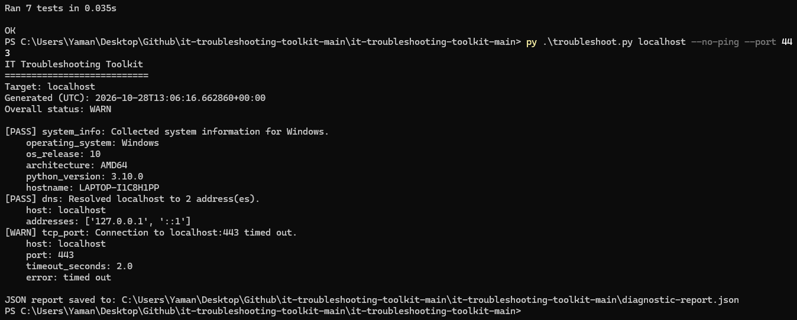

# IT Troubleshooting Toolkit

A lightweight Python command-line utility for collecting basic system and network diagnostics. It is designed as a portfolio demonstration of structured troubleshooting, defensive error handling, JSON reporting, and automated unit testing.

> **Safety and scope:** This tool performs read-only checks. It collects basic local system information, resolves a supplied hostname, optionally sends one ping, and attempts TCP connections only to ports explicitly provided by the user. It does not scan port ranges, change system settings, or transmit application data. Only test hosts and ports you are authorized to access.


## Demo




## Features

- Local OS, architecture, hostname, and Python version summary
- DNS lookup with unique IP addresses
- Optional single-packet ping (ICMP can be blocked, so a failed ping is not proof that a host is down)
- TCP connectivity check for explicitly selected ports
- `PASS`, `WARN`, and `FAIL` statuses with explanatory details
- Human-readable console output and a timestamped JSON report
- Unit tests using mocks, so the test suite does not require network access
- Python standard library only; no third-party dependencies

## Requirements

- Windows 10/11, macOS, or Linux
- Python 3.10 or later

## Setup on Windows

1. Install Python 3.10+ from [python.org](https://www.python.org/downloads/windows/). During installation, enable **Add Python to PATH**.
2. Open PowerShell and move into the project directory:

   ```powershell
   cd path\to\it-troubleshooting-toolkit
   ```

3. (Optional but recommended) Create and activate a virtual environment:

   ```powershell
   py -m venv .venv
   .\.venv\Scripts\Activate.ps1
   ```

4. No package installation is required; the project uses only the Python standard library.

## Usage

Run a basic diagnostic against a hostname you are allowed to test:

```powershell
py .\troubleshoot.py example.com
```

Test HTTPS and DNS service ports explicitly:

```powershell
py .\troubleshoot.py example.com --port 443 --port 53
```

Skip ping if ICMP is blocked or not desired:

```powershell
py .\troubleshoot.py example.com --no-ping --port 443
```

Choose a different JSON report location:

```powershell
py .\troubleshoot.py example.com --port 443 --json .\reports\example-report.json
```

Create the `reports` directory first if it does not exist. The default report filename is `diagnostic-report.json` in the current working directory.

## Run the tests

From the project root:

```powershell
py -m unittest discover -s tests -v
```

The tests mock DNS and socket operations where appropriate, so they validate success/error handling without depending on a live remote service.

## How to interpret results

- **PASS** — the check completed successfully.
- **WARN** — the check could not confirm connectivity (for example, ping timed out). A warning is not necessarily an outage.
- **FAIL** — the check failed, such as DNS resolution failure or a refused TCP connection.

A TCP connection test only confirms whether a connection could be established at that moment. It does not prove that the application behind the port is healthy. Firewalls, VPNs, proxies, routing, and endpoint policies may affect results.

## Troubleshooting workflow demonstrated

1. Confirm the target hostname and scope.
2. Review local system information.
3. Check DNS resolution.
4. Check basic reachability, remembering that ICMP may be blocked.
5. Test only the required TCP service ports.
6. Review the report, compare findings with the reported symptoms, and document next steps.

## Project structure

```text
it-troubleshooting-toolkit/
├── troubleshoot.py
├── README.md
└── tests/
    └── test_troubleshoot.py
```

## Current limitations and possible improvements

- No graphical interface or log-file parser yet
- No continuous monitoring or automatic remediation
- Platform-specific ping output is included as diagnostic text and is not parsed into latency metrics
- A future version could add CSV export, structured logging, configuration profiles, and CI testing

## Portfolio summary

**Role:** Personal project / Python developer  
**Technologies:** Python, `argparse`, `socket`, `subprocess`, JSON, `unittest`  
**Focus:** IT troubleshooting, DNS, TCP connectivity, error handling, report generation, and test automation

**Description:** Built a command-line diagnostic tool that gathers basic system information, checks DNS resolution and selected TCP ports, and exports a structured JSON report. Added automated unit tests with mocked network calls to validate normal and failure paths without relying on external services.

*Publish this description only after you have run the project and tests yourself, and adjust it to reflect any changes you make.*
